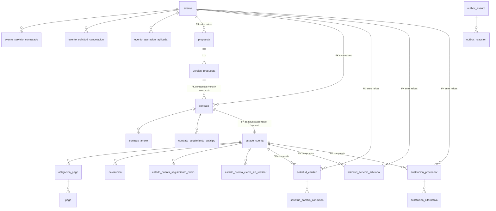

# Esquema relacional de Eventos Nova en PostgreSQL 18

**Estado:** diseño implementado por etapas. TP-01 se considera **resuelta por el equipo** (`resolucion-tp01.md`); el estado de cada etapa (migración, mapeadores, repositorios, unidad de trabajo, Outbox, API) se registra en `registro-progreso-persistencia-fase2.md`. La elección de PostgreSQL es decisión del equipo, no del profesor.
**Fuentes:** código de `src/domain`, `src/application`, `src/infrastructure`; ADR-001 a ADR-005; cierre de alcance aprobado (TP-01, TP-02, TP-06); README.
**No se usaron** los CSV genéricos del paquete PIA como definición del esquema.
**Implementación:** `src/infrastructure/esquema_postgresql.py` (metadatos SQLAlchemy Core) y `migraciones/versions/0001_esquema_inicial.py` (Alembic).

## 1. Alcance

Incluye el almacenamiento de los siete agregados y del Outbox de ADR-004 (22 tablas). No incluye repositorios SQL, mapeadores, `UnitOfWork` persistente, despachador, codec de eventos ni conexión de la API.

## 2. Agregados y tablas

Las siete raíces (todas heredan de `AggregateRoot`, `domain/base.py`) son las que exponen los puertos `I*Repository` de `application/puertos.py`:

| Raíz de agregado | Clase | Tabla raíz | Tablas hijas (dentro del agregado) |
|---|---|---|---|
| Propuesta | `domain/propuesta.py` | `propuesta` | `version_propuesta` (entidad `VersionPropuesta`) |
| Contrato | `domain/contrato.py` | `contrato` | `contrato_anexo` (`AnexoContrato`), `contrato_seguimiento_anticipo` |
| Evento | `domain/evento.py` | `evento` | `evento_servicio_contratado` (`ServicioContratado`), `evento_solicitud_cancelacion` (`SolicitudCancelacion`), `evento_operacion_aplicada` |
| SolicitudCambio | `domain/solicitudes.py` | `solicitud_cambio` | `solicitud_cambio_condicion` |
| SolicitudServicioAdicional | `domain/solicitudes.py` | `solicitud_servicio_adicional` | — |
| SustitucionProveedor | `domain/solicitudes.py` | `sustitucion_proveedor` | `sustitucion_alternativa` (`AlternativaPropuesta`) |
| EstadoCuenta | `domain/estado_cuenta.py` | `estado_cuenta` | `obligacion_pago`, `pago`, `devolucion`, `estado_cuenta_seguimiento_cobro`, `estado_cuenta_cierre_sin_realizar` |
| (Outbox, ADR-004) | `infrastructure/unidad_trabajo.py` | `outbox_evento` | `outbox_reaccion` |

No se crea tabla para: `Importe`, `DatosEvento`, `Decision`, etc. (objetos de valor), las máquinas de estado, las Specifications, los Domain Services ni `EventoDominio` como agregado.

## 3. Estrategia de persistencia de objetos de valor

| Caso | Representación | Ejemplos |
|---|---|---|
| VO escalar o pequeño de un solo uso | Columnas incrustadas en la tabla del agregado, con prefijo | `DatosEvento` → `tipo`, `fecha_hora`, `lugar`, `invitados_aproximados` en `evento` |
| VO opcional con varios campos | Columnas anulables + `CHECK` «todo o nada» (o todas nulas o todas informadas) | `Decision`, `MotivoCierreSolicitud`, `MotivoCancelacionEvento`, `RevisionAdministrativa`, `PlazoPago`, `ImpactoModificacion` |
| Colección de VO sin identidad y sin consultas | Arreglo PostgreSQL `TEXT[]` | `servicios`, `proveedores_considerados` |
| Colección de entidades o VO consultables / con identidad | Tabla hija con `posicion` para conservar el orden | `pago`, `obligacion_pago`, `sustitucion_alternativa` |
| Tupla `(fecha, resultado)` | Tabla hija | `contrato_seguimiento_anticipo` |
| Diccionario `{id: VO}` | Tabla hija con clave `(padre, id)` | `solicitud_cambio_condicion`, `evento_servicio_contratado` |
| Enumeraciones | `VARCHAR(40)` con el *nombre* del miembro (`EN_ORGANIZACION`) + `CHECK` derivado del Enum | todos los `estado` |

Tipos de datos:

- **Importes:** `NUMERIC` **sin precisión ni escala** y nunca `float`. `Importe` es `Decimal`, no admite negativos y el dominio no fija máximo ni escala, así que no se inventan (incremento 2.1; antes `NUMERIC(14,2)`). El `CHECK` exige valor no negativo **y finito**: en PostgreSQL `'NaN' >= 0` es verdadero y `NUMERIC` sin precisión admite `NaN` e `Infinity`, por lo que `>= 0` por sí solo no basta (comprobado con consultas de solo lectura sobre literales en PostgreSQL 18.6).
- **Fechas y horas:** `TIMESTAMP` **sin zona**. El dominio usa fechas locales sin zona (`datetime.now`) y el cierre mantiene `America/Mexico_City` (TP-06). No se convierte ni se reinterpreta nada.
- **Identificadores:** `TEXT`. El dominio genera ids con prefijo (`nuevo_id`: `PREFIJO-xxxxxxxx`) y derivados (`{contrato}-S1`, `{propuesta}-v2`); no son UUID.
- **Días naturales / hábiles y plazos:** no se persiste ningún cálculo. `Devolucion.fecha_limite` (5 días hábiles, GL-060) se calcula siempre; los plazos se guardan solo como `plazo_inicio` / `plazo_vence` tal como los fija `PlazoPago`.
- **Estado transitorio no persistido:** `AggregateRoot._eventos` (viaja por el Outbox), `ConfiguracionComparable`, `CondicionTemporal`, `ResultadoViabilidad` derivados de especificaciones, y propiedades como `pendiente`, `aplica_cargo_tardio`, `importes_a_cobrar`, `iniciado`, `saldo_vencido_sin_regularizar`.
- **Estado privado que sí se persiste** porque la rehidratación fiel lo necesita: `Evento._operaciones_aplicadas`, `EstadoCuenta._ventana_resuelta`, `EstadoCuenta._cierres_sin_realizar`, `_SolicitudBase._estado_antes_de_detener`.

## 4. Diccionario de datos

Convenciones: PK = clave primaria; «anul.» = admite NULL; `pos` = `posicion INTEGER NOT NULL`. Las columnas de invitados son `BIGINT` (sección 13.2).

### 4.1 Propuesta
**`propuesta`** — PK `propuesta_id`.
`evento_id`, `cliente_id` (TEXT, referencias por id); `estado` (`EstadoPropuesta`); `version_vigente_id` (FK compuesta diferida `(propuesta_id, version_vigente_id)` → `version_propuesta (propuesta_id, version_id)`, GL-008); `motivo_cierre` (anul.).
**`version_propuesta`** — PK `version_id`; FK `propuesta_id` → `propuesta` (cascade); UNIQUE (`propuesta_id`, `numero`).
`numero`, `fecha_actualizacion`, `servicios TEXT[]`, `proveedores_considerados TEXT[]`, `costo_total NUMERIC`, `condiciones`.

### 4.2 Contrato
**`contrato`** — PK `contrato_id`. `evento_id`, `propuesta_id`, `version_aceptada_id`; `servicios TEXT[]`, `costo_total`, `condiciones` (`CondicionesContractuales`); `politica_incluida`, `politica_comunicada_en` (anul.); `estado`; `fecha_firma` (anul.).
**`contrato_seguimiento_anticipo`** — PK (`contrato_id`, `pos`): `fecha`, `resultado`. El primer seguimiento fija el límite de 24 h (`limite_pago_anticipo`).
**`contrato_anexo`** — PK `anexo_id`; FK `contrato_id`; UNIQUE (`contrato_id`, `origen_id`); `tipo_origen` (`TipoSolicitud`), `origen_id`, `descripcion`, `fecha`, `pos`.

### 4.3 Evento
**`evento`** — PK `evento_id`. `cliente_id`; datos del evento; `servicios_solicitados TEXT[]`; `estado`; `fecha_inicio`, `fecha_finalizacion` (anul.); `motivo_cancelacion_{origen,descripcion,fecha,registrado_por}` (grupo anul.); `revision_{resultado,pagos_realizados,saldo_pendiente,politica_incluida,constancia_no_reembolso,fecha}` (grupo anul.).
**`evento_servicio_contratado`** — PK (`evento_id`, `servicio_contratado_id`): `servicio`, `proveedor_id` (anul.), `condiciones`, `estado` (`EstadoServicioContratado`), `pos`.
**`evento_solicitud_cancelacion`** — PK (`evento_id`, `pos`): `fecha`, `motivo`, `estado`.
**`evento_operacion_aplicada`** — PK (`evento_id`, `operacion_id`).

### 4.4 Solicitudes
Columnas comunes (`_SolicitudBase`) en las tres tablas: `evento_id`, `contrato_id`, `estado_cuenta_id`, `anexo_id` (anul.), `obligacion_pago_id` (anul.), `motivo_cierre_{causa,descripcion,fecha}` (grupo anul.), `estado`, `estado_antes_de_detener` (anul.).
Cada `Decision` opcional se guarda como `<prefijo>_{actor,aprobada,fecha,motivo}`.

**`solicitud_cambio`** — PK `solicitud_id`. Además: `descripcion`; `anticipacion_fecha_solicitud`, `anticipacion_fecha_evento`; `tarifa_importe`; `datos_propuestos_{tipo,fecha_hora,lugar,invitados}` (grupo anul.); `viabilidad_{viable,motivo}` (anul.); `impacto_afecta_{servicios,costos,condiciones}` (anul.); `costo_proveedor` (anul.); `decision_cliente_*`; `autorizacion_*`; `importes_por_pagar BOOLEAN`.
**`solicitud_cambio_condicion`** — PK (`solicitud_id`, `servicio_contratado_id`): `condiciones`, `pos`.
**`solicitud_servicio_adicional`** — PK `solicitud_id`. Además: `servicio`; anticipación (2 fechas); `elegibilidad_obtenida`; `disponibilidad_{proveedor_id,disponible,costo,condiciones}` (anul.); `decision_cliente_*`; `autorizacion_*`.
**`sustitucion_proveedor`** — PK `sustitucion_id`. Además: `servicio_contratado_id`, `proveedor_original_id`, `costo_adicional` (anul.), `aprobada_despues_del_limite`.
**`sustitucion_alternativa`** — PK (`sustitucion_id`, `pos`): `proveedor_id`, `disponibilidad_*`, `impacto_afecta_*` (obligatorios), `decision_cliente_*`, `autorizacion_*`. La alternativa vigente es la de mayor `pos`.

### 4.5 EstadoCuenta
**`estado_cuenta`** — PK `estado_cuenta_id`; UNIQUE `contrato_id`; `evento_id`; `resultado_regularizacion` (`Regularizado` / `No regularizado`, anul.); `fecha_resultado_regularizacion`; `ventana_resuelta_obligacion_id`.
**`obligacion_pago`** — PK (`estado_cuenta_id`, `obligacion_id`); UNIQUE (`estado_cuenta_id`, `concepto`, `origen_id`); `concepto` (`ConceptoPago`), `importe`, `plazo_inicio` / `plazo_vence` (grupo anul.), `origen_id`, `estado`, `pos`.
**`pago`** — PK (`estado_cuenta_id`, `pago_id`); FK compuesta (`estado_cuenta_id`, `obligacion_id`) → `obligacion_pago`; `importe`, `fecha`, `comprobante`, `estado`, `registrado_en`, `verificado_en` (anul.), `pos`.
**`devolucion`** — PK (`estado_cuenta_id`, `devolucion_id`); `solicitud_id`, `concepto`, `importe`, `motivo_devolucion`, `fecha_cierre`, `estado`, `fecha_devolucion`, `comprobante` (anul.), `pos`.
**`estado_cuenta_seguimiento_cobro`** — PK (`estado_cuenta_id`, `pos`): `seguimiento`.
**`estado_cuenta_cierre_sin_realizar`** — PK (`estado_cuenta_id`, `origen_id`): `fecha_cierre`, `evento_cancelado`.

### 4.6 Outbox
Ver sección 8.

## 5. Claves y cardinalidades

Cardinalidades de dominio: un Evento tiene n Propuestas y n Contratos (los puertos devuelven listas); un Contrato tiene un EstadoCuenta (UNIQUE); un Evento tiene n solicitudes de cada tipo. Las claves foráneas **entre raíces** se limitan a las que el código confirma (decisión D-01, sección 13.1) y no tienen cascada de borrado (`NO ACTION`). Las claves foráneas **dentro de un agregado** usan `ON DELETE CASCADE` (el borrado de la raíz elimina su agregado; hoy ningún caso de uso borra agregados). Las referencias que permanecen sin clave foránea se enumeran con su motivo en la sección 13.1.

## 6. Restricciones e índices (con justificación)

| Restricción | Dónde | Trazabilidad |
|---|---|---|
| `CHECK estado IN (...)` | todos los estados | Derivado de los `Enum` del dominio (`valores.py`). Se incluye `EN_EVALUACION` de SolicitudCambio por la compatibilidad histórica AR-05. |
| `CHECK importe >= 0 AND importe <> 'NaN' AND importe <> 'Infinity'` (nombre `*_valido`) | las 12 columnas de importes (anulables: `IS NULL OR (...)`) | `Importe`: «El importe no puede ser negativo» (`valores.py`) y finitud exigida por el requisito de validación de datos. |
| `CHECK tipo <> '' AND lugar <> ''` | `evento`; equivalente anulable en `solicitud_cambio.datos_propuestos_*` | `DatosEvento`: `not tipo or not lugar` (CA-003). No prohíbe dígitos ni caracteres. |
| `CHECK invitados > 0` | `evento`, `solicitud_cambio.datos_propuestos_invitados` | Invariante de `DatosEvento` (CA-003). |
| `CHECK politica_incluida` | `contrato` | El constructor de `Contrato` la exige (CA-016). |
| `CHECK cardinality(servicios) > 0 AND condiciones <> ''` | `version_propuesta` | `ContenidoPropuesta` (CA-005). |
| `UNIQUE (propuesta_id, numero)` | `version_propuesta` | Número consecutivo, sin repetir (BN-002, CA-007). |
| `UNIQUE (contrato_id, origen_id)` | `contrato_anexo` | «La operación ya tiene un anexo registrado». |
| `UNIQUE (contrato_id)` | `estado_cuenta` | «Un EstadoCuenta por contrato» (decisión arquitectónica, docstring de `EstadoCuenta`). |
| `UNIQUE (propuesta_id, version_id)` en `version_propuesta`; `UNIQUE (contrato_id, evento_id)` en `contrato`; `UNIQUE (estado_cuenta_id, contrato_id)` en `estado_cuenta` | las tres tablas | Destino de las claves foráneas compuestas que garantizan pertenencia (versión de la misma propuesta; estado de cuenta del mismo contrato y evento). No añaden regla: la clave primaria ya es única (sección 13.1). |
| `UNIQUE (estado_cuenta_id, concepto, origen_id)` | `obligacion_pago` | Idempotencia de `EstadoCuenta._crear`. |
| `CHECK todo-o-nada` en VO opcionales | varias | Coherencia estructural del VO incrustado; no impone regla de negocio. |
| `UNIQUE (padre, posicion)` | tablas con orden | Reconstrucción fiel del orden de las listas. |

**Deliberadamente no impuestas** (podrían contradecir reglas vigentes o dependen de rutas del código):
- No hay `CHECK plazo_vence > plazo_inicio`: el plazo del saldo usa `inicio = fecha del evento` y `vence` anterior (`restar_dias_habiles`).
- No hay `CHECK` que ligue estado y fechas (p. ej. `VERIFICADO ⇒ verificado_en`, `EFECTUADA ⇒ comprobante`): el dominio lo garantiza hoy, pero la regla no está declarada como invariante.
- No hay `CHECK` de transiciones de estado: las máquinas de estado siguen siendo la única fuente.
- Las referencias a filas hijas de otro agregado, a identificadores polimórficos y a conceptos sin tabla no tienen clave foránea (sección 13.1).

Índices (12). Los puertos actuales cargan agregados completos (`obtener_por_id`, `listar_por_evento_id`, `listar_todos`) y los *handlers* CQRS filtran en memoria; por eso solo se justifican estrictamente los índices de acceso de los puertos. Los demás son anticipatorios para futuras lecturas en SQL y se marcan como provisionales.

| Índice | Justificación | Tipo |
|---|---|---|
| `evento_id` en `propuesta`, `contrato`, `estado_cuenta` | `listar_por_evento_id` (puertos) | puerto |
| (`evento_id`, `estado`) en las tres solicitudes | `listar_pendientes_por_evento_id` / `listar_por_evento_id` | puerto |
| `fecha_hora` en `evento` | `ConsultarEventosProximosHandler`: ventana [desde, hasta] de todos los estados (no filtra por estado) | provisional |
| parcial `obligacion_pago (estado, plazo_vence) WHERE PENDIENTE/VENCIDA` | `ConsultarPagosPendientesHandler` (orden por fecha límite) | provisional |
| parcial `devolucion (fecha_cierre) WHERE PENDIENTE` | `ConsultarDevolucionesPendientesHandler`; el límite exacto se calcula (5 días hábiles), no se indexa | provisional |
| `evento_servicio_contratado.proveedor_id` | `ConsultarServicioAsignadoHandler` (`s.proveedor_id == q.proveedorId`) | provisional |
| `pago (estado_cuenta_id, obligacion_id)` | soporte de la FK compuesta y su `ON DELETE CASCADE` | FK |
| parcial `outbox_evento (secuencia) WHERE PENDIENTE` | lectura del despachador (`estado == "Pendiente"`) | Outbox |
| PK/UNIQUE (incluye `estado_cuenta.contrato_id`, `outbox_evento.evento_id`) | `obtener_por_contrato_id`, idempotencia | restricción |

Corrección de la revisión posterior a la interrupción: se eliminaron 12 índices que no respondían a ninguna consulta del código (`estado_cuenta_id` y `estado` solos en las solicitudes, `evento.cliente_id`, `contrato.propuesta_id`, `devolucion.solicitud_id`, `obligacion_pago.origen_id`, `outbox_evento.agregado_id` y el parcial de `REVISION`) y se sustituyó (`estado`, `fecha_hora`) por `fecha_hora`, porque la consulta de eventos próximos no filtra por estado. Todos deben confirmarse con el plan de ejecución cuando existan los repositorios SQL.

## 7. Trazabilidad con el dominio

| Elemento del dominio | Persistencia |
|---|---|
| `Propuesta.versiones`, `version_vigente_id` | `version_propuesta`, FK compuesta `propuesta (propuesta_id, version_vigente_id)` |
| `Contrato.seguimientos_anticipo`, `anexos`, `politica`, `condiciones` | tablas hijas y columnas incrustadas |
| `Evento.servicios`, `solicitudes_cancelacion`, `motivo_cancelacion`, `revision_administrativa`, `_operaciones_aplicadas` | tablas hijas y grupos de columnas |
| `_SolicitudBase` (anexo, obligación, motivo de cierre, `_estado_antes_de_detener`) | columnas comunes |
| `EstadoCuenta.obligaciones`, `pagos`, `devoluciones`, `seguimientos_cobro`, `_cierres_sin_realizar`, `_ventana_resuelta` | tablas hijas |
| `Devolucion.fecha_limite`, `en_plazo`, `vencida` | **calculados, no persistidos** |
| `RegistroOutbox.estado/intentos/error/reacciones_procesadas` | `outbox_evento`, `outbox_reaccion` |

## 8. Eventos de dominio y Outbox

ADR-004 decide guardar los Domain Events en un Outbox **en el mismo commit** que el agregado y despacharlos después con reacciones idempotentes en transacciones propias; el cierre de alcance lo deja como trabajo posterior (TP-02) «en la misma base de datos que los agregados». Por eso la migración inicial incluye la estructura (sin lógica):

**`outbox_evento`** — una fila por Domain Event (`RegistroOutbox`).

| Columna | Justificación |
|---|---|
| `secuencia BIGINT IDENTITY` (PK) | Orden estable de despacho (equivale al orden de la lista en memoria). |
| `evento_id` (UNIQUE) | `EventoDominio.evento_id` (uuid4): idempotencia al insertar y referencia de `outbox_reaccion`. |
| `tipo_evento` | Nombre de la clase; el codec futuro lo usará para reconstruir el evento frozen. |
| `agregado_id`, `ocurrido_en` | Campos base de `EventoDominio`. |
| `datos JSONB` (objeto) | Campos propios de cada uno de los 31 tipos (`evento_ref`, `numero`, `proveedor_id`, ...). Se usa JSONB porque son hechos inmutables, con campos distintos por tipo, que solo se leen completos para reconstruir el evento. Tres eventos llevan VO (`CambioConfirmado.datos_propuestos` / `condiciones_propuestas`, `ServicioAdicionalConfirmado.condiciones`): el codec deberá serializarlos con etiqueta de tipo. **No se serializan agregados.** |
| `estado` (`PENDIENTE`, `PROCESADO`, `REVISION`), `intentos`, `error` | Mismo contenido que `RegistroOutbox` (en memoria: «Pendiente», «Procesado», «Revisión»). |

Índice parcial: `PENDIENTE` por `secuencia` (lo que escanea el despachador). Los registros en `REVISION` son terminales y no se consultan en el código actual.

**`outbox_reaccion`** — PK (`evento_id`, `clave_reaccion`); solo guarda las parejas ya ejecutadas (`reacciones_procesadas`); permite reintentar únicamente las que fallaron (ADR-004). `procesada_en` registra cuándo.

**Rehidratación y recuperación.** Los eventos viven solo en `outbox_evento`: el repositorio debe reconstruir los agregados con `_eventos` vacío (como hace hoy `guardar()` en memoria) para que cargar un agregado nunca vuelva a emitir eventos; `AggregateRoot` no necesita columna de eventos. Tras una interrupción, las filas `PENDIENTE` y las parejas de `outbox_reaccion` ya ejecutadas sobreviven, de modo que el despachador reintenta solo las reacciones que faltan (ADR-004). `evento_id` UNIQUE impide duplicar un evento si el commit se reintenta. Los registros `PROCESADO` no se purgan en este diseño (política de retención pendiente).

**Pendiente de diseño (no implementado):** el despachador deberá bloquear filas (`FOR UPDATE SKIP LOCKED`) y `max_intentos` sigue siendo configuración del despachador, no columna.

## 9. Contradicciones y decisiones pendientes

| Id | Asunto | Tratamiento |
|---|---|---|
| C-01 | **TP-01** (cierre de alcance aprobado, sin modificar). | **Resuelta por el equipo el 2026-10-24** (ver sección 11 y `resolucion-tp01.md`). Se conserva la trazabilidad de la condición original. |
| C-02 | Coherencia solicitud–contrato–evento: ninguna regla aprobada exige que `solicitud.evento_id` sea el evento del contrato; el sistema acepta hoy una combinación incoherente. | **Implementado como decisión del equipo E-2 (2026-10-25), sin aprobación formal:** los servicios de aplicación rechazan (HTTP 422) una solicitud cuyo `evento_id` no es el del contrato; sin FK nueva. Ver sección 13.3 y `DECISIONES_E1_E4.md`. |
| D-09 | Enteros de invitados: la API y el dominio aceptaban enteros de cualquier tamaño. | **Resuelta (2.4):** `BIGINT` con límite técnico 9223372036854775807 validado en dominio y API (no es un máximo de negocio). Ver sección 13.2. |
| D-01 | Relaciones entre agregados. | **Recomendación del incremento 2.4, no aprobada formalmente por el equipo:** mantener las claves foráneas actuales, sin nuevas relaciones entre raíces. Razones y condiciones en la sección 13.1. |
| D-02 | Escala y máximo de importes. El dominio no fija ninguno (solo `porcentaje()` redondea a 0,01). | **Resuelto en el diseño (2.1):** `NUMERIC` sin precisión ni escala; no se impone máximo ni escala. Pendiente: si el negocio aprueba una escala (p. ej. centavos) o un límite, se valida primero en API/dominio y después, si se desea, en la base. El redondeo de `quantize` de Python (a par) y el de PostgreSQL (mitad hacia fuera) difieren (10.125 → 10.12 frente a 10.13), por lo que el mapeador no debe redondear. |
| D-03 | La clave de reacción del Outbox es `__qualname__#índice` y el índice depende del orden de suscripción. | Estabilizar la clave antes del Outbox persistente. |
| D-04 | `Evento.servicios` como diccionario: el orden se conserva con `posicion`; `servicio_contratado_id` es único por evento (no globalmente). | Revisar si `SustitucionProveedor.servicio_contratado_id` debe referenciar la tabla. |
| D-08 | `estado_antes_de_detener` existe en `sustitucion_proveedor` porque lo define `_SolicitudBase`, aunque esa solicitud no tiene estado «Detenida». | Columna anulable inocua; revisar al implementar el mapeador. |
| D-05 | Valor `EN_EVALUACION` (AR-05, heredado). | Se permite en el `CHECK` por compatibilidad. |
| D-06 | `Pago.comprobante` y `Devolucion.comprobante` aceptan cadena vacía. | Sin `CHECK`; el dominio no lo prohíbe. |
| D-07 | Control de concurrencia (versión de agregado / bloqueo optimista) no existe en el dominio. | Fuera de alcance; evaluar en el incremento de repositorios. |
| R-01 | `ON DELETE CASCADE` y el `downgrade` eliminan datos si se usan. | El `downgrade` solo se debe ejecutar en desarrollo. |
| D-10 | Los identificadores se generan con 8 caracteres hexadecimales (`nuevo_id`). El guardado por *upsert* sobrescribiría un agregado ante una colisión de ids (improbable, pero posible a gran escala; el almacén en memoria tiene el mismo comportamiento). | **Resuelta (fase final, Etapa 2).** Los ids nuevos son prefijo + UUID v4 completo (122 bits aleatorios); los históricos de 8 caracteres siguen siendo válidos (las columnas son `TEXT`). La colisión es estadísticamente improbable, no imposible: la creación de cada raíz comprueba que el id no exista (`nuevo_id_libre`), `EstadoCuenta` rechaza obligaciones y pagos con id repetido y la clave primaria protege en la base. Pruebas: `test_identificadores`. |
| D-11 | Sin control de concurrencia optimista (versión de agregado): dos escrituras simultáneas del mismo agregado se resuelven «gana la última». | **Resuelta (fase final, Etapa 3).** Revisión `0004`: columna `version` en las siete raíces; `guardar` usa `UPDATE ... WHERE version = <leída>` y lanza `ConflictoDeConcurrencia` (HTTP 409) si otra transacción cambió el agregado; la operación entera se revierte. Solo compiten escrituras del mismo agregado. Los repositorios en memoria no usan versión. Pruebas: `test_concurrencia_optimista` (hilos reales). |
| D-12 | El Outbox ejecuta la reacción y la anota en dos transacciones; el orden por `secuencia` es de inserción, no de confirmación. | **Documentada y probada.** Entrega *al menos una vez* con deduplicación por reacción (clave estable módulo.Clase.método); NO se afirma «exactamente una vez». Las reacciones deben ser idempotentes (ADR-004); un conflicto de concurrencia en una reacción se reintenta. El orden de un mismo agregado se conserva. |
| D-13 | `proveedor_original_id` era `NOT NULL` pero el dominio admite un servicio sin proveedor asignado. | **Resuelta** con la revisión `0002` (hallazgo de las pruebas HTTP sobre PostgreSQL). |

## 10. Validación realizada (sin aplicar la migración)

**Incremento 2.4** (resultados reales): metadatos importados (22 tablas); `alembic heads` → `0001 (head)`; `alembic history` → una sola revisión; SQL offline de `upgrade` y de `downgrade` generados con código 0, sin `DROP`/`DELETE`/`TRUNCATE` en `upgrade`, con `invitados_aproximados BIGINT NOT NULL` y `datos_propuestos_invitados BIGINT`; evaluación de `CHECK` en PostgreSQL 18.6 de solo lectura: 174 de 174 casos coinciden (incluye `2147483648` y `9223372036854775807` en `BIGINT`, y la comprobación de que `9223372036854775808` y `10^30` no caben en la columna); suite completa 906 pruebas (889 + 17 nuevas), todas `OK`. Registro en `tests/evidencias/ejecucion-pruebas-fase2-inc24-20261024.txt`. La migración no se aplicó y la base sigue con 0 tablas.

**Incremento 2.2** (sigue vigente en lo demás):

Incremento 2.2 (vigente). Resultados reales de la ejecución; el detalle de cada caso de `CHECK` está en `tests/evidencias/ejecucion-pruebas-fase2-inc22-20261024.txt`.

| Validación | Método | Resultado |
|---|---|---|
| Importación de metadatos | `python -W error`: 22 tablas, 12 índices, 27 columnas numéricas (12 importes, 15 enteros), ningún nombre de restricción > 63 caracteres | Aprobada |
| Revisión única | `alembic heads` / `alembic history`; prueba `Migracion.test_una_sola_revision_inicial` | Aprobada: solo `0001`, sin padre |
| DDL offline de la migración | `alembic upgrade head --sql` (sin conexión) y prueba automática | Aprobada; sin `DROP`, `DELETE` ni `TRUNCATE` |
| Reversión offline | `alembic downgrade head:base --sql` (solo genera texto) | Aprobada; no se ejecutó contra la base |
| Metadatos frente a migración | Conjuntos de líneas de DDL normalizadas (espacios y comas finales) | Sin diferencias. **Límite:** detecta errores de transcripción; la migración se genera desde los metadatos, así que no prueba que el diseño sea correcto ni la equivalencia semántica completa. La revisión manual (orden de FK, restricciones diferidas, `downgrade`) es independiente |
| Orden de creación | Ninguna FK apunta a una tabla creada después; el único ciclo (`propuesta` ↔ `version_propuesta`) usa `ALTER TABLE` diferido | Aprobada |
| `CHECK` en PostgreSQL 18.6 | Las expresiones reales de los metadatos se evalúan con `SELECT (expr) IS NOT FALSE` sobre literales, en una conexión con `default_transaction_read_only=on` (170 casos: negativo, cero, positivo, decimal largo, valor de 31 dígitos, `NaN`, `Infinity`, `-Infinity`, `NULL`, enteros y textos) | 170 de 170 coinciden con lo esperado |
| `alembic upgrade` / `downgrade` | No se ejecutaron | La base sigue con 0 tablas |

## 11. TP-01: condición original y resolución

**Condición originalmente aprobada** (`Cierre_Alcance_Eventos_Nova_FINAL_APROBADO_20261023.md`, sección «4. Decisiones técnicas pendientes», fila TP-01): «Persistencia tras reinicio — Bloqueada hasta recibir la base de datos oficial (README)». El archivo de cierre **no se modifica**.

**Resolución del equipo (2026-10-24)**, registrada en `docs/architecture/resolucion-tp01.md`: el ZIP `16_Eventos_Nova` es la fuente oficial de datos recibida; el equipo construye la base de datos relacional; PostgreSQL 18 es la tecnología elegida por el equipo; los CSV se usan según su propósito documentado y el esquema se deriva del dominio, no de convertir cada CSV en una tabla.

Se distinguen cuatro hechos:

| Hecho | Situación |
|---|---|
| PostgreSQL 18 elegido como motor | Decisión técnica **del equipo** (ADR-005). El PIA no nombra ningún motor; no consta que el profesor lo haya impuesto ni aprobado |
| Recepción de la fuente oficial de datos | Resuelta por el equipo: `16_Eventos_Nova` |
| Condición TP-01 | Resuelta por el equipo para continuar con la implementación; el texto original se conserva como historia |
| Habilitación de la persistencia | Se realiza por etapas con pruebas (ver `registro-progreso-persistencia-fase2.md`) |

Cada capa se distingue así:

| Capa | Responsabilidad |
|---|---|
| Validación en la entrada (API) | Forma y tipo del dato: texto no numérico, `NaN`/infinitos, booleanos como enteros, rango técnico |
| Invariantes del dominio | Importe finito, no negativo y `Decimal`; datos del evento completos y bien tipados; dinero siempre como `Importe` |
| Restricciones de base de datos | Últimas barreras: `CHECK`, `NOT NULL`, `UNIQUE`, claves foráneas |
| Comprobaciones de aplicación | Existencia de las referencias sin clave foránea (sección 13.1) |
| Reglas de negocio aprobadas | Dominio y servicios; no cambian con la persistencia |

## 12. Matriz de validación de datos

Leyenda de pruebas: **PD** = `tests/test_validacion_datos_dominio.py`; **PA** = `tests/test_validacion_datos_api.py`; **PE** = `tests/test_esquema_postgresql.py`; **PC** = `tests/test_esquema_postgresql_checks.py` (evalúa la expresión SQL real en PostgreSQL, solo lectura). «Dominio» = invariante del dominio. «API» = validación en la entrada HTTP. Solo `costo_total` de la propuesta y los datos del evento tienen hoy un esquema de entrada HTTP; los demás importes entran por los servicios de aplicación y solo los protege el dominio.

### 12.1 Importes (12 columnas)

Todas: tipo `NUMERIC` sin precisión ni escala; **no admiten negativos**; **admiten cualquier número de decimales** (el dominio no fija escala ni máximo); **requieren valor finito**; restricción `CHECK x >= 0 AND x <> 'NaN' AND x <> 'Infinity'` (en las anulables `x IS NULL OR (...)`); validación de dominio `Importe` (Decimal exacto, finito, no negativo; rechaza `float`, `int`, `bool`, `str`, `None`); pruebas **PD** (`ImporteValido`, `ImporteRechazado`), **PC** (12 casos por columna).

| Tabla.campo | Significado | `NULL` | Entrada / API | Prueba adicional | Pendiente |
|---|---|---|---|---|---|
| `version_propuesta.costo_total` | Costo total de la versión de propuesta (CA-005) | No | `CrearPropuestaEntrada.costo_total`: `Decimal`; rechaza texto, vacío, `NaN`, `Infinity`, `True`/`False`, `null` y ausente (422 estándar); negativos llegan al dominio y se devuelven como rechazo de negocio (422 `rechazo_de_negocio`) | **PA** `CostoTotal`; **PD** `ContenidoPropuesta` | Límite de dígitos y escala: no definidos por ninguna regla aprobada |
| `contrato.costo_total` | Costo del contrato, copiado de la versión aceptada | No | Sin entrada HTTP; `CondicionesContractuales` exige `Importe` | **PD** `ObjetosDeValorConDinero` | Esquema de entrada si se expone |
| `solicitud_cambio.tarifa_importe` | Tarifa del cargo por cambio tardío (BN-003) | No | Sin entrada HTTP; `TarifaCargoTardio` exige `Importe` | **PD** | Esquema de entrada cuando se exponga la solicitud de cambio |
| `solicitud_cambio.costo_proveedor` | Costo adicional del proveedor | Sí (sin viabilidad) | Sin entrada HTTP; llega de `DisponibilidadProveedor` | **PD** | Ídem |
| `solicitud_servicio_adicional.disponibilidad_costo`, `sustitucion_alternativa.disponibilidad_costo` | Costo informado por el proveedor | Sí (proveedor no disponible) | `DisponibilidadProveedor.costo` exige `Importe` si no es `None` | **PD** | Ídem |
| `sustitucion_proveedor.costo_adicional` | Costo adicional de la sustitución | Sí | Sin entrada HTTP | **PC** | Ídem |
| `obligacion_pago.importe`, `pago.importe`, `devolucion.importe` | Obligaciones, pagos registrados y devoluciones | No | Servicios de aplicación reciben `Importe`; sin entrada HTTP | **PD**, **PC** | Esquemas de entrada de pagos y devoluciones cuando se expongan |
| `evento.revision_pagos_realizados`, `revision_saldo_pendiente` | Revisión administrativa tras cancelar (CA-089 a CA-091) | Sí (sin revisión) | Calculados por la aplicación (`Importe`) | **PC** | Ninguno |

Redondeo: ninguna columna ni validación redondea. El único redondeo del dominio sigue siendo `Importe.porcentaje()` (`quantize(0.01)`, anticipo del 30 %, BN-009), probado sin cambios en **PD**. El paquete de pruebas del PIA trabaja en centavos (`ejecucion_paquete/totales.py`): es una convención de ese paquete, no del dominio.

### 12.2 Cantidades y contadores (enteros)

| Tabla.campo | Significado | Tipo | Negativos | Decimales | `NULL` | Restricción SQL | Dominio / API | Prueba | Pendiente |
|---|---|---|---|---|---|---|---|---|---|
| `evento.invitados_aproximados` | Invitados aproximados (CA-003) | `BIGINT` | No (> 0) | No | No | `CHECK > 0` | Dominio: entero (no `bool`), `> 0` y `<= 9223372036854775807` (límite técnico). API: `le=9223372036854775807`; rechaza texto no numérico, `12.5`, `"1e2"`, `True`/`False`, `null` y ausente; acepta `"12"` y `12.0` (contrato existente); `0` y negativos los rechaza el dominio (CA-003) | **PA** `InvitadosAproximados`, `LimiteTecnicoDeInvitadosApi`; **PD** `DatosEventoTipos`, `LimiteTecnicoDeInvitados`; **PE** `EnterosYLimiteTecnico`; **PC** | Máximo de invitados **de negocio**: no definido por ninguna fuente aprobada |
| `solicitud_cambio.datos_propuestos_invitados` | Ídem, en datos propuestos | `BIGINT` | No (> 0) | No | Sí (grupo opcional) | `CHECK IS NULL OR > 0` | `DatosEvento` (mismo límite técnico). **Sin ruta HTTP**: entra por `registrar_solicitud_cambio(datos_propuestos=DatosEvento)`; no se probó por API | **PD** `LimiteTecnicoDeInvitados`, **PE**, **PC** | Esquema de entrada HTTP cuando se exponga la solicitud de cambio |
| `version_propuesta.numero` | Número de versión (BN-002) | `INTEGER` | No (>= 1) | No | No | `CHECK >= 1`, `UNIQUE (propuesta_id, numero)` | Lo genera `Propuesta` (consecutivo) | **PC** | Ninguno: no es entrada |
| `outbox_evento.intentos` | Reintentos del despachador | `INTEGER` | No (>= 0) | No | No | `CHECK >= 0` | `RegistroOutbox.intentos` solo se incrementa | **PC** | Ninguno |
| `outbox_evento.secuencia` | Orden de despacho | `BIGINT IDENTITY` | n/a | No | No | PK | Generado por la base | — | Ninguno |
| `posicion` (tablas hijas) | Orden en la lista | `INTEGER` | No (técnico) | No | No | `UNIQUE` con la clave del padre | Derivado del índice de la lista | — | Opcional: `CHECK >= 0` |

### 12.3 Campos de texto

Ninguna fuente aprobada (BRD, historias, glosario, cierre, ADR, PIA) establece una restricción alfabética, de longitud o de formato para un campo de texto, y el dominio no tiene campos de nombre de persona, teléfono, correo ni dirección (el cliente se identifica por `cliente_id`). **No se inventó ninguna regla de «solo letras»**: los dígitos y signos son válidos en todos los textos.

| Tabla.campo | Significado | Tipo | `NULL` | Restricción SQL | Dominio / API | Prueba | Pendiente |
|---|---|---|---|---|---|---|---|
| `evento.tipo`, `evento.lugar` (y `solicitud_cambio.datos_propuestos_tipo/lugar`) | Tipo de evento y lugar (descripciones) | `TEXT` | No (los de datos propuestos: grupo opcional) | `CHECK tipo <> '' AND lugar <> ''` | Dominio: `str` y no vacío (CA-003). API: `str`; rechaza números, booleanos, listas, `null`; acepta dígitos («Boda 2», «Av. Juárez #123», «123») | **PA** `CamposDeTexto`, **PD** `DatosEventoTipos`, **PC** | Texto de solo espacios: el dominio lo acepta y no se añade `TRIM` (no hay regla aprobada) |
| `version_propuesta.condiciones`, `servicios` | Condiciones y servicios de la propuesta | `TEXT`, `TEXT[]` | No | `CHECK cardinality(servicios) > 0 AND condiciones <> ''` | Dominio: no vacíos (CA-005). API: `str` / lista de `str` | **PA**, **PD** | Validar en el dominio el tipo de cada servicio (hoy solo la API lo hace) |
| `contrato.condiciones`, `contrato.servicios` | Copiadas de la versión aceptada | `TEXT`, `TEXT[]` | No | Ninguna | Sin validación propia | — | Definir si deben repetir el `CHECK` de la propuesta |
| `evento.servicios_solicitados`, `evento_servicio_contratado.servicio/condiciones` | Servicios del evento | `TEXT[]`, `TEXT` | No | Ninguna | Sin validación de contenido | — | Ídem |
| `*_id` (identificadores y folios) | Ids con prefijo (`PR-1a2b3c4d`, `{id}-S1`, `{id}-v2`) y referencias | `TEXT` | Según el atributo | Ninguna: pueden ser alfanuméricos | Sin validación de formato | — | Definir formato si la API recibe ids externos |
| `comprobante`, `motivo`, `descripcion`, `seguimiento`, `resultado` | Descripciones libres | `TEXT` | Según el atributo | Ninguna | Sin validación | — | Definir con el negocio si pueden ir vacíos |

### 12.4 Otros campos

Fechas y horas (`TIMESTAMP` sin zona, `America/Mexico_City`, TP-06; API `NaiveDatetime`), estados (`VARCHAR(40)` con `CHECK` derivado de los `Enum`), booleanos y `ARRAY`/`JSONB` del Outbox se documentan en las secciones 3, 4, 6 y 8.

### 12.5 Discrepancias detectadas y estado

| # | Discrepancia | Estado |
|---|---|---|
| 1 | `Importe` aceptaba `Decimal("Infinity")`; `NaN` fallaba con `InvalidOperation` | **Corregida** (`ErrorDominio`, con pruebas) |
| 2 | `Importe` aceptaba `float`, `int`, `bool`, `str` | **Corregida**: solo `Decimal` (la suite completa solo lo construía con `Decimal`) |
| 3 | `ContenidoPropuesta`, `CondicionesContractuales`, `TarifaCargoTardio` y `DisponibilidadProveedor` aceptaban un `Decimal` negativo o `NaN` sin pasar por `Importe` | **Corregida** (exigen `Importe`) |
| 4 | `DatosEvento` aceptaba `tipo`/`lugar` no textuales, `bool` e `int` falsos en invitados | **Corregida** |
| 5 | La API convertía `True` en 1 invitado | **Corregida** (se rechaza) |
| 6 | `CHECK >= 0` dejaba pasar `NaN` en PostgreSQL | **Corregida** (desde 2.1; probada en 2.2) |
| 7 | Texto de solo espacios aceptado por el dominio | **Pendiente**: sin regla aprobada |
| 8 | Los textos de otras entidades (contrato, servicios, comprobantes) no se validan en el dominio | **Pendiente**: sin regla aprobada |
| 9 | Sin esquemas de entrada HTTP para pagos, devoluciones, tarifas y solicitudes | **Pendiente**: no están expuestos |
| 10 | `solicitudes.evento_id` no se valida contra `contrato.evento_id` en los servicios | **Pendiente de confirmación formal**: sin regla aprobada no se implementa; ver 13.3 |
| 11 | La API y el dominio aceptaban enteros de cualquier tamaño en invitados, que no caben en la columna | **Corregida (2.4)**: `BIGINT` y límite técnico validado antes de persistir |

## 13. Integridad referencial (D-01) y tipos enteros

### 13.1 Claves foráneas

Criterio: hay clave foránea hacia una **raíz** cuando el código confirma que existe al crear el agregado; las referencias a filas hijas de otro agregado, a identificadores polimórficos o a conceptos sin tabla quedan como **referencia blanda**. Entre raíces no hay cascada de borrado (`NO ACTION`); la cascada solo existe entre una raíz y sus propias hijas.

| Referencia | Clave foránea | Evidencia en el código | Diferida |
|---|---|---|---|
| `propuesta.evento_id` | → `evento` | `crear_propuesta` exige un evento existente | No |
| `propuesta (propuesta_id, version_vigente_id)` | → `version_propuesta (propuesta_id, version_id)` | La versión vigente es de la misma propuesta (`{id}-v{n}`; `version_aceptada()` la busca en `self.versiones`) | **Sí** (`INITIALLY DEFERRED`, `ALTER TABLE`): propuesta y primera versión se insertan en la misma transacción |
| `contrato.evento_id` | → `evento` | `preparar_contrato` parte de una propuesta de ese evento | No |
| `contrato (propuesta_id, version_aceptada_id)` | → `version_propuesta (propuesta_id, version_id)` | `Contrato(…, p.id, v.version_id, …)`; también garantiza que la propuesta exista | No |
| `estado_cuenta (contrato_id, evento_id)` | → `contrato (contrato_id, evento_id)` | `EstadoCuenta(nuevo_id, contrato_id, c.evento_id)` | No |
| `solicitud_*`/`sustitucion_proveedor.evento_id` | → `evento` | El servicio obtiene el evento con `_existente` | No |
| `solicitud_*`/`sustitucion_proveedor (estado_cuenta_id, contrato_id)` | → `estado_cuenta (estado_cuenta_id, contrato_id)` | `_estado_cuenta_del_contrato(contrato_id)` | No |

Referencias que **permanecen sin clave foránea**, con motivo:

| Referencia | Motivo |
|---|---|
| `contrato_anexo.origen_id`, `obligacion_pago.origen_id`, `estado_cuenta_cierre_sin_realizar.origen_id`, `devolucion.solicitud_id`, `outbox_evento.agregado_id` | Identificadores **polimórficos**: apuntan a una de varias tablas |
| `solicitud_cambio/_servicio_adicional/sustitucion.anexo_id`, `obligacion_pago_id` | Apuntan a **filas hijas** de otro agregado (`contrato_anexo`, `obligacion_pago`); su protección depende de cómo se persistan esas hijas (actualización o reemplazo), decisión de los repositorios SQL |
| `sustitucion_proveedor.servicio_contratado_id` | Fila hija de `Evento` (`evento_servicio_contratado`): igual que el anterior |
| `cliente_id`, `proveedor_id`, `proveedor_original_id`, `proveedores_considerados` | No existen tablas de clientes ni de proveedores en el dominio |
| Coherencia `solicitud.evento_id` = `contrato.evento_id` | Ningún servicio la valida hoy; imponerla sería una regla nueva |

**Estado de D-01.** Decisión operativa del equipo para la implementación: **mantener las claves foráneas actuales (incluidas las compuestas de versión vigente y aceptada) y no incorporar nuevas relaciones entre raíces de agregado por ahora**. Razones:

- **Transacciones (ADR-004):** cada raíz se confirma en su propia transacción y las reacciones se ejecutan después, también por separado. Las claves foráneas actuales apuntan siempre a una raíz ya confirmada.
- **Orden de guardado:** evento, propuesta y versiones, contrato, estado de cuenta, solicitudes: el orden en que el código crea los agregados; la única clave diferida es la circular propuesta ↔ versión.
- **Independencia de los agregados:** el dominio usa identificadores y no mantiene referencias directas a otros agregados. Las comprobaciones de existencia se hacen en la capa de aplicación, mediante los puertos de repositorio.
- **Sin cascadas de borrado entre raíces** (`NO ACTION`) y sin métodos de borrado en los puertos.

**Referencias que permanecen sin clave foránea.** Para cada una se indica su naturaleza, dónde se comprueba hoy su existencia y el límite de la protección. **Sin FK, PostgreSQL no protege por sí solo la referencia frente a escrituras SQL directas**; la integridad la garantiza la aplicación durante las operaciones admitidas, y esta garantía no cubre inserciones manuales ni procesos ajenos a la aplicación.

| Referencia | Naturaleza | Comprobación en la aplicación | Límite |
|---|---|---|---|
| `contrato_anexo.origen_id` (+ `tipo_origen`) | Polimórfica, obligatoria | Los servicios `registrar_anexo_*` obtienen la solicitud por su repositorio (`_existente`) y pasan `s.id`; la reacción `al_registrarse_anexo` la vuelve a leer | Una escritura directa podría dejar un origen inexistente |
| `obligacion_pago.origen_id` | Polimórfica (contrato o solicitud), obligatoria | Se crea desde un contrato o solicitud ya recuperados por su repositorio | Ídem |
| `devolucion.solicitud_id`, `estado_cuenta_cierre_sin_realizar.origen_id` | Polimórfica, obligatoria | `aplicar_cierre_sin_realizar` se invoca desde reacciones con el `id` de una solicitud recuperada | Ídem |
| `solicitud_*.anexo_id` | Opcional, fila hija de otro agregado | `al_registrarse_anexo` la asigna a partir del evento `AnexoContratoRegistrado`, tras leer la solicitud | Ídem |
| `solicitud_*.obligacion_pago_id` | Opcional, fila hija de otro agregado | `comunicar_solicitud_pago*` crea la obligación y marca la solicitud en la misma operación | Ídem |
| `sustitucion_proveedor.servicio_contratado_id` | Obligatoria, fila hija de `Evento` | El servicio exige `_existente(ev.servicios.get(...))` antes de crear la sustitución | Ídem |
| `cliente_id` (evento y propuesta) | Obligatoria, sin agregado Cliente | **No verificable**: no existe repositorio de clientes | Sin protección; es un identificador externo |
| `proveedor_id`, `proveedor_original_id`, `proveedores_considerados` | Externa | Provienen del servicio de disponibilidad (`IConsultaDisponibilidadProveedor`), no de un repositorio | Sin protección |
| `outbox_evento.agregado_id` | Polimórfica, histórica | Lo asigna el agregado que genera el evento | Ídem |

Las pruebas que demuestran estas comprobaciones sobre los repositorios SQL se registran en `registro-progreso-persistencia-fase2.md` (Etapa 4). **Riesgo no eliminable sin una restricción SQL adicional:** una escritura directa en la base (fuera de la aplicación) puede crear referencias huérfanas en las filas de esta tabla.

**Reservado** (no se implementa): FK compuestas opcionales como `(estado_cuenta_id, obligacion_pago_id)` o `(contrato_id, anexo_id)`, cuando el equipo lo decida con los repositorios SQL ya validados. Condición para los repositorios: guardar las hijas con *upsert* por clave primaria y no con «borrar y reinsertar».

### 13.2 Tipos enteros y límite técnico

El límite **9223372036854775807** (2^63 − 1) es un **límite técnico de almacenamiento** del entero de 64 bits con signo. **No es un máximo de invitados definido por el negocio**: ninguna fuente aprobada lo establece. Un valor superior se rechaza antes de persistir, con el mecanismo de rechazo de negocio existente (HTTP 422), y no con un error del controlador de la base (HTTP 500).

| Columna | Tipo | Origen del dato | Decisión |
|---|---|---|---|
| `evento.invitados_aproximados` | **`BIGINT`** (antes `INTEGER`) | Entrada HTTP (`DatosEventoEntrada`) | Cambiada: la API y el dominio aceptaban enteros de cualquier tamaño y `INTEGER` fallaba desde 2 147 483 648 |
| `solicitud_cambio.datos_propuestos_invitados` | **`BIGINT`** (antes `INTEGER`) | `DatosEvento` del dominio; sin ruta HTTP | Cambiada, mismo límite |
| `version_propuesta.numero` | `INTEGER` | Lo genera la propuesta (`max + 1`), una por petición | Se mantiene: no es una entrada del usuario |
| `outbox_evento.intentos` | `INTEGER` | Contador interno acotado por `max_intentos` | Se mantiene |
| `posicion` (10 tablas hijas) | `INTEGER` | Índice de lista generado por el sistema | Se mantiene |
| `outbox_evento.secuencia` | `BIGINT IDENTITY` | Generado por la base | Ya era `BIGINT` |

Validación del límite (una sola constante, `domain.valores.MAXIMO_TECNICO_BIGINT`):

- **Dominio:** `DatosEvento` rechaza con `ErrorDominio` los valores superiores (cubre la API, los servicios y el paquete PIA, que construyen `DatosEvento`). Mensaje: «Los invitados aproximados superan el límite técnico de almacenamiento (9223372036854775807); no es un máximo de negocio.»
- **API:** `DatosEventoEntrada.invitados_aproximados` usa `le=MAXIMO_TECNICO_BIGINT`; un valor superior devuelve el 422 estándar de validación. Si alguien esquiva el esquema, el dominio lo rechaza igualmente.
- **Conservado:** cero y negativos (CA-003), `bool`, fraccionarios, texto no numérico, y las cadenas numéricas que la API ya admitía (`"12"`).
- `BIGINT` mantiene el `CHECK > 0` sin cambios y no se añadió ningún máximo a las restricciones SQL.

### 13.3 Coherencia solicitud–contrato–evento (riesgo documentado; validación E-2 implementada después)

> **Actualización 2026-10-25.** El equipo implementó la validación en los tres servicios de registro (decisión E-2, sin aprobación formal; `tests/test_coherencia_solicitud_contrato_evento.py`). No se añadió ninguna clave foránea. El texto siguiente describe la situación y la decisión **anteriores** y se conserva como antecedente.

**Situación actual (comprobada en memoria).** Con dos eventos contratados (A y B) en la misma aplicación, `registrar_solicitud_cambio(evento B, contrato de A, …)` fue **aceptada**: la solicitud quedó con `evento_id` de B y con `contrato_id` y `estado_cuenta_id` de A. Los servicios obtienen el evento por `evento_id` y el estado de cuenta por `contrato_id`, y no comparan ambos. **Corrección de la fase final:** con las 60 operaciones actuales sí es alcanzable por HTTP (`POST /solicitudes-cambio`, `POST /solicitudes-servicio-adicional` y `POST /sustituciones` reciben `evento_id` y `contrato_id`); la prueba `test_riesgo_coherencia_solicitud_contrato_evento` lo documenta. Nota: este «C-02» es el identificador del riesgo en este documento y no la regla C-02 del cierre de alcance (cierre de solicitudes en T).

**Respaldo normativo.** No se encontró ninguna regla aprobada que exija expresamente que el evento de la solicitud sea el del contrato. Las fuentes sugieren esa intención (el estado de cuenta agrupa, por contrato, lo «correspondiente al evento»; el código impide un segundo contrato activo por evento), pero es una inferencia y no una regla.

**Decisión de este incremento.** No se implementa la validación `contrato.evento_id == evento_id`, no se añade una clave foránea compuesta que la imponga y no se cambian las firmas de los servicios. Requiere **confirmación formal del responsable**.

**Riesgos:** un cambio se aplicaría a un evento mientras sus pagos se cargan a la cuenta de otro; las consultas por evento mostrarían datos cruzados. **Alternativas** (todas requieren aprobar la regla): validar en los tres servicios de registro; añadir además una FK compuesta `(estado_cuenta_id, contrato_id, evento_id)` con un `UNIQUE` adicional; o derivar `evento_id` del contrato.

## 14. Implementación de la persistencia (Fase 2)

| Componente | Módulo | Qué hace | Pruebas |
|---|---|---|---|
| Migraciones | `migraciones/versions/0001_esquema_inicial.py`, `0002_proveedor_original_opcional.py`, `0003_devolucion_anticipo_contratacion_cerrada.py`, `0004_version_de_agregado.py` | Esquema de 22 tablas; la `0002` relaja `proveedor_original_id`; la `0004` añade la versión para la concurrencia optimista (ADR-006). Aplicadas a desarrollo (head 0004) | `test_esquema_postgresql*`, `test_migraciones_ciclo` |
| Mapeadores | `infrastructure/persistencia/mapeadores.py` | Un mapeador por raíz (SQLAlchemy Core, sin ORM); rehidratación con `__new__` + `AggregateRoot.__init__`: **no se ejecutan los constructores y no se emiten eventos** | `test_persistencia_mapeadores` |
| Repositorios SQL | `persistencia/repositorios_sql.py` | Implementan los puertos `I*Repository`; *upsert* por clave primaria (nunca «borrar y reinsertar»); sin métodos de borrado; listados ordenados por identificador (el almacén en memoria devuelve el orden de inserción) | `test_persistencia_repositorios` (mismas pruebas de contrato en memoria y SQL) |
| Unidad de trabajo | `persistencia/unidad_trabajo_sql.py` | Una operación = una transacción por hilo, sin anidar; eventos al Outbox en la misma transacción; libera siempre la conexión | `test_persistencia_unidad_trabajo` |
| Outbox | `persistencia/outbox_sql.py`, `codec_eventos.py` | 31 tipos de evento, JSONB versionado; reclamo `FOR NO KEY UPDATE SKIP LOCKED`; claves estables de reacción; reintentos y paso a Revisión | `test_persistencia_codec_eventos`, `test_persistencia_outbox` |
| Composición | `persistencia/composicion_persistente.py`, `infrastructure/composicion.py` | `construir_persistente(...)` con la misma estructura que `construir(disponibilidad=None)`; comprueba conexión y esquema al arrancar | `test_persistencia_composicion` |
| API | `src/api/` | 47 operaciones POST y 13 consultas GET; errores de persistencia → 409/422/503/500 | `test_api_operaciones` (memoria y PostgreSQL), `test_api_persistencia` |
| Trabajador | `persistencia/trabajador_outbox.py` | Bucle independiente: en cada ciclo aplica la llegada de T (`procesar_eventos_vencidos`, un evento por transacción, con `reloj_negocio`, America/Mexico_City, TP-06) y después despacha el Outbox (ADR-008); usa el índice `ix_evento_fecha_hora` | `test_api_persistencia`, `test_persistencia_conexion` |
| Docker / CI | `Dockerfile`, `docker-compose.yml`, `.github/workflows/` | DB + migrate + API + worker + tests | `docker compose run --rm tests` |

**Orden de guardado y claves foráneas.** Cada raíz se guarda en su propia transacción (ADR-004) en el orden natural del dominio: evento → propuesta/versiones → contrato → estado de cuenta → solicitudes. Dentro de un agregado el repositorio inserta la raíz y luego las filas hijas; la única clave diferida (`propuesta.version_vigente_id`) permite insertar propuesta y versión en la misma transacción. Una referencia que no cumple una clave foránea produce `ViolacionDeRestriccion` y la transacción se revierte completa.

**Lo que garantiza cada capa** (resumen de las secciones 11 a 13): PostgreSQL, las restricciones y claves foráneas; la aplicación, la existencia de las referencias sin clave foránea; las reglas de negocio aprobadas, el dominio. La coherencia solicitud–contrato–evento (C-02) no está garantizada por ninguna capa.

**Hallazgos de la implementación** (todos con prueba): el `NOT NULL` de `proveedor_original_id` (D-13); la confirmación de que una operación revertida no deja eventos ni cambios parciales; que un valor `NaN` o negativo que esquive el dominio lo rechaza la base de datos; y que `guardar` es idempotente.

### 14.1 Revisión 0003: devolución del anticipo (decisión A)

Cambio aditivo aplicado a desarrollo y pruebas: `estado_cuenta.cierre_contratacion`; `devolucion.tipo` (`SOLICITUD_NO_REALIZADA` para las filas existentes, `ANTICIPO_CONTRATACION_CERRADA`), `devolucion.pago_id`, `devolucion.fecha_referencia`; `devolucion.solicitud_id` admite NULL. Restricciones: `ck_devolucion_tipo_valido`, `ck_devolucion_origen_segun_tipo` (SE-012 exige solicitud; la del anticipo exige pago, fecha de referencia y concepto Anticipo) e índice único parcial `uq_devolucion_pago` (como máximo una devolución por pago, C-11). La bajada falla sin modificar nada si ya existen devoluciones del anticipo (no se inventa una solicitud). Reglas y supuestos: `docs/trazabilidad/complemento-trazabilidad-fase-final.md`.

### 14.2 Revisión 0004: control de concurrencia optimista

Cambio aditivo aplicado a desarrollo y pruebas: `version BIGINT NOT NULL DEFAULT 0` (con `CHECK version >= 0`) en `propuesta`, `contrato`, `evento`, `solicitud_cambio`, `solicitud_servicio_adicional`, `sustitucion_proveedor` y `estado_cuenta`. Las filas existentes quedan en la versión 0. Un agregado nuevo se inserta con `ON CONFLICT DO NOTHING` y, si el id ya existe, falla en vez de sobrescribir; un agregado leído se actualiza solo si su versión sigue siendo la leída. Límite: no hay reintento automático en la API (el cliente recibe 409 y repite); el Outbox sí reintenta la reacción.
